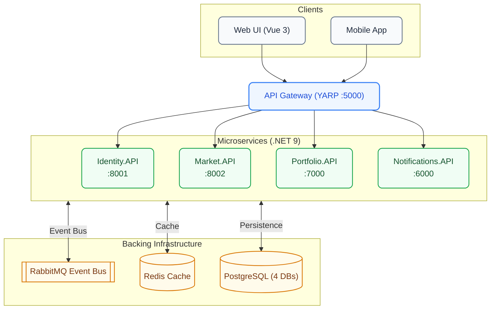

<div align="center">

# CryptoMarket

A modern, real-time cryptocurrency market platform built with .NET 9 microservices, asynchronous event-driven messaging, and high-frequency trading simulation.

[](https://dotnet.microsoft.com/)
[](https://www.postgresql.org/)
[](https://www.rabbitmq.com/)
[](https://redis.io/)
[](https://microsoft.github.io/reverse-proxy/)
[](https://www.docker.com/)
[](LICENSE)

</div>

---

## Key Features

- **Microservices Architecture:** 4 domain services (Identity, Market, Portfolio, Notifications) isolated behind a single YARP API Gateway.
- **Real-Time Market Simulation:** Live price and supply simulation background services streaming tick data via SignalR WebSockets and RabbitMQ.
- **Automated Limit Order Engine:** Fast limit order price matching against real-time streams utilizing Redis for fast evaluation.
- **Asynchronous Event-Driven Bus:** Reliable inter-service workflows orchestrated via MassTransit over RabbitMQ.
- **Database-per-Service:** Complete physical data isolation with independent PostgreSQL databases per microservice.
- **AI-Powered Market News:** Automated synthetic market news generation integrated with Google Gemini AI.
- **End-to-End Observability:** Distributed tracing across all HTTP endpoints and RabbitMQ message hops via OpenTelemetry and Jaeger.

---

## Architecture

All client requests enter through the API Gateway, while microservices communicate asynchronously over the event bus:



*For detailed specifications, queue bindings, and container mappings, see [Containers Architecture (C4 Level 2)](docs/architecture/containers.md).*

---

## Technology Stack

- **Platform:** .NET 9.0 (C# 13)
- **API Gateway:** YARP (Yet Another Reverse Proxy)
- **Message Broker:** RabbitMQ 3 with MassTransit
- **Databases:** PostgreSQL 16+ via EF Core (Npgsql)
- **Distributed Cache:** Redis 6.2
- **Real-Time Push:** ASP.NET Core SignalR
- **Observability:** OpenTelemetry .NET SDK + Jaeger
- **External AI:** Google Gemini REST API

---

## Quick Start

Launch the entire system (all 5 services, PostgreSQL, Redis, RabbitMQ, and Jaeger) using Docker Compose:

```bash
git clone https://github.com/ibrahimkabadayi/Identity.API.git
cd Identity.API
cp .env.example .env
docker compose up -d --build
```

The API Gateway is immediately available at `http://localhost:5000`.

*For local debugging, IDE configuration, database update commands, and troubleshooting, see the [Running Locally Guide](docs/operations/running-locally.md).*

---

## Documentation

Full architectural specifications, database models, decision logs, and API reference documentation live in the [`docs/`](docs/) directory:

- **[Documentation Index](docs/README.md)** — Start here for a map of all documentation.
- **[Architecture](docs/architecture/)** — [System Context (C4 L1)](docs/architecture/context.md), [Containers (C4 L2)](docs/architecture/containers.md), [Deployment](docs/architecture/deployment.md), and [Messaging Topology](docs/architecture/messaging-topology.md).
- **[Database](docs/database/)** — Per-service ERDs, cross-service logical relationships, and Redis keys catalog.
- **[Domain & Sequence Flows](docs/flows/)** — Step-by-step sequence diagrams for trading, limit orders, and transfers.
- **[Event Catalog](docs/events.md)** — Message contracts, publisher and subscriber matrix.
- **[Architecture Decisions (ADRs)](docs/decisions/)** — Architectural decision records including database per service and MongoDB to PostgreSQL migration.
- **[API Reference](docs/api/)** — Endpoint reference tables and OpenAPI specs.
- **[Operations](docs/operations/)** — Local environment setup, glossary, and system limitations.
- **[Contributing Guide](docs/CONTRIBUTING-DOCS.md)** — Documentation conventions, Mermaid guidelines, and PR quality checklist.

---

## License

This project is licensed under the MIT License. See [LICENSE](LICENSE) for details.
