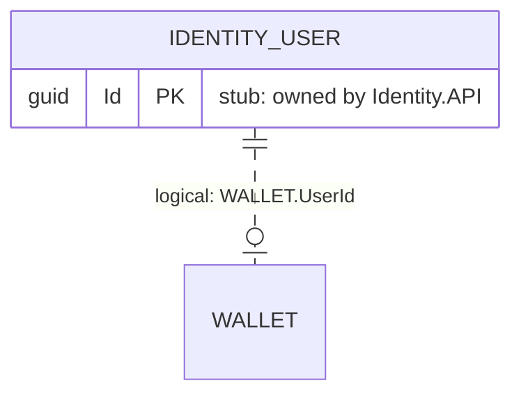

# Contributing to CryptoMarket Documentation

> This document defines the rules, conventions, and quality gates for all documentation in the `docs/` directory.  
> Every contributor (human or AI agent) **must** follow these rules.

---

## Operating Rules

1. **No invention.** Every factual claim must come from code, config, git history, or an owner note. End each document with a `Sources:` list of repo file paths. Use `TODO(verify)` for anything uncertain and `TODO(owner)` for rationale only the owner can provide.

2. **Document the current code**, not the desired design. Known gaps go to [`docs/operations/known-limitations.md`](operations/known-limitations.md).

3. **No secrets.** Never copy connection strings, JWT keys, passwords, or API keys into docs. List configuration keys by name only.

4. **Mermaid only** for diagrams, and every diagram must compile (validate with `@mermaid-js/mermaid-cli`, `mmdc`).

5. **One phase per PR/commit series.** Stop after each phase and wait for owner approval before starting the next.

6. **Relocate, don't delete.** When slimming the README, move its content into the right doc page first; only then remove it from the README.

7. **ADR rationale comes from the owner.** The agent may extract *evidence* (code paths, git history) but must not write the "why" itself. See Phase 7 in the implementation plan.

8. **Stamp diagrams** with `Last verified against commit: <short hash>` so staleness is detectable.

---

## Diagram Legend

All diagrams in this repository use **Mermaid** syntax. The following conventions apply across all diagram types.

### ER Diagram Conventions

| Element | Mermaid Syntax | Meaning |
|---|---|---|
| Solid line | `\|\|--o{` or similar | **Physical foreign key** — an actual FK constraint exists in the database |
| Dashed line | `\|\|..o{` or similar | **Logical (cross-service) reference** — no FK constraint; the column holds an ID from another service's database |
| Stub entity | Entity with `Id PK` only + comment `"stub: owned by <service>"` | **Entity owned by another service** — shown only to illustrate cross-service relationships |

### Stub Entity Example



### Sequence Diagram Conventions

- Participants are named after real services, classes, or components in the codebase.
- Use `alt` / `opt` / `par` fragments only when the code actually branches.
- Show at least one failure/alternative path per diagram.
- Include the source of `userId` (JWT) where relevant.

### General Diagram Rules

- Every diagram block must include a `Last verified against commit: <short hash>` stamp directly below it.
- Use descriptive titles in diagram comments (`%% Title: ...`).
- Keep diagrams focused — one concept per diagram; split large diagrams into multiple files if necessary.

---

## Naming Conventions

### Files and Directories

| Type | Convention | Example |
|---|---|---|
| Directories | lowercase, hyphens | `docs/architecture/` |
| Markdown files | lowercase, hyphens | `messaging-topology.md` |
| Per-service files | `<service-lowercase>-<topic>.md` | `portfolio-db.md`, `market-class-diagram.md` |
| Generated files | placed in `generated/` subdirectory | `docs/database/generated/portfolio.mmd` |
| ADR files | `NNNN-short-title.md` | `0001-database-per-service.md` |
| Flow files | descriptive name matching the flow | `create-limit-order.md` |

### Headings and Cross-References

- Use a single `# H1` per page (the document title).
- Use relative links for cross-references within `docs/` (e.g., `[containers](architecture/containers.md)`).
- Link to source files using relative paths from the repo root (e.g., `Portfolio.API/Controllers/WalletController.cs`).

---

## Document Template

Every documentation page should follow this general structure:

```markdown
# Page Title

> Brief one-line description of what this page covers.

---

(main content here)

---

## Sources

- `path/to/relevant/file.cs`
- `path/to/config/file.yml`
```

---

## PR Checklist for Documentation Changes

Before submitting a documentation PR, verify the following:

- [ ] All Mermaid diagrams compile (`mmdc` or Mermaid Live Editor)
- [ ] Every document ends with a `Sources:` section
- [ ] No secrets (connection strings, keys, passwords) appear anywhere
- [ ] All internal links resolve to existing files
- [ ] `TODO(verify)` and `TODO(owner)` items are listed in the PR description
- [ ] Diagram stamps (`Last verified against commit:`) are present and current
- [ ] New files follow the naming conventions above
- [ ] Generated files in `generated/` directories have not been hand-edited
- [ ] If schema, events, or routes changed: matching docs have been updated

---

## Sources

- `CRYPTOMARKET_DOCS_IMPLEMENTATION_PLAN.md` — Phase 0, Section 1 (Agent operating rules)
