# Containers (C4 Level 2)

> Container-level view of the CryptoMarket platform: microservices, gateway, message broker, caching layer, databases, and external dependencies.

---

## Container Diagram

The platform follows an asynchronous, event-driven microservices architecture fronted by a unified reverse proxy gateway (YARP). Every persistent microservice owns an isolated PostgreSQL database, while inter-service workflows are orchestrated asynchronously via MassTransit over RabbitMQ.

```mermaid
flowchart TB
    %% Last verified against commit: b5229aa

    subgraph Clients ["Client Layer"]
        WebClient["Web UI<br/>[Vue 3 SPA :5173]"]
        MobileClient["Mobile App<br/>[Flutter Client]"]
    end

    subgraph GatewayLayer ["Gateway Layer"]
        Gateway["API.Gateway<br/>[ASP.NET Core / YARP]<br/>Port 5000:8080<br/>Single entry point & route dispatcher"]
    end

    subgraph Microservices ["Microservices Layer (.NET 9)"]
        IdentityAPI["Identity.API<br/>Port 8001:8080<br/>Auth, registration, JWT tokens"]
        MarketAPI["Market.API<br/>Port 8002:8080<br/>Price simulation, market news, charts"]
        PortfolioAPI["Portfolio.API<br/>Port 7000:8080<br/>Wallets, asset trading, limit orders"]
        NotificationsAPI["Notifications.API<br/>Port 6000:8080<br/>Alerts, push notifications, email"]
    end

    subgraph Messaging ["Message Broker"]
        RabbitMQ[["RabbitMQ<br/>[MassTransit AMQP :5672]<br/>Asynchronous event bus"]]
    end

    subgraph Caching ["Caching & Idempotency"]
        Redis[("Redis 6.2<br/>Port 6379<br/>Coin prices & limit order cache")]
    end

    subgraph Persistence ["Persistence Layer (PostgreSQL :5432)"]
        IdentityDb[("IdentityDb<br/>Users & roles")]
        MarketDb[("MarketDb<br/>Coins, news, price history")]
        PortfolioDb[("PortfolioDb<br/>Wallets, assets, orders, txs")]
        NotificationsDb[("NotificationsDb<br/>Notifications & price alerts")]
    end

    subgraph External ["External Services"]
        GeminiAPI["Google Gemini API<br/>Synthetic news generation"]
        SMTPServer["SMTP Server<br/>Transactional welcome email"]
    end

    subgraph Observability ["Observability"]
        Jaeger["Jaeger<br/>OTLP :4317 / UI :16686<br/>Distributed tracing"]
    end

    %% Client traffic
    WebClient & MobileClient -->|"HTTP & WebSocket (SignalR)"| Gateway

    %% Gateway Routing
    Gateway -->|"/api/auth"| IdentityAPI
    Gateway -->|"/api/market, /api/market-news<br/>/hubs/market"| MarketAPI
    Gateway -->|"/api/wallet, /api/wallets, /api/limit-orders<br/>/hubs/portfolio"| PortfolioAPI
    Gateway -->|"/api/notifications, /api/price-alerts<br/>/hubs/notifications"| NotificationsAPI

    %% Persistence connections
    IdentityAPI -->|"EF Core Npgsql"| IdentityDb
    MarketAPI -->|"EF Core Npgsql"| MarketDb
    PortfolioAPI -->|"EF Core Npgsql"| PortfolioDb
    NotificationsAPI -->|"EF Core Npgsql"| NotificationsDb

    %% Redis Cache connections
    MarketAPI -->|"market:coins, coins:supply"| Redis
    PortfolioAPI -->|"Idemp_{key}, {correlationId}, {symbol}Orders"| Redis
    NotificationsAPI -->|"{symbol}Alerts"| Redis

    %% RabbitMQ Events (Publish)
    IdentityAPI -->|"UserCreatedEvent"| RabbitMQ
    MarketAPI -->|"CoinPriceEvent, BuyCoinEvent, LimitOrderPlacedEvent"| RabbitMQ
    PortfolioAPI -->|"LimitOrderOccuredEvent, AssetTransferEvent, FeeCollectionEvent"| RabbitMQ

    %% RabbitMQ Events (Consume)
    RabbitMQ -->|"UserCreatedEvent, CoinPriceEvent, LimitOrderPlacedEvent, BuyCoinEvent"| PortfolioAPI
    RabbitMQ -->|"UserCreatedEvent, CoinPriceEvent, LimitOrderOccuredEvent, AssetTransferEvent"| NotificationsAPI

    %% External calls
    MarketAPI -->|"HTTPS REST"| GeminiAPI
    NotificationsAPI -->|"SMTP"| SMTPServer

    %% Tracing
    IdentityAPI & MarketAPI & PortfolioAPI & NotificationsAPI & Gateway -.->|"OTLP gRPC traces"| Jaeger

    classDef client fill:#dbeafe,stroke:#2563eb,color:#1e3a8a,rx:6
    classDef gateway fill:#fef3c7,stroke:#d97706,color:#78350f,rx:6
    classDef service fill:#dcfce7,stroke:#16a34a,color:#14532d,rx:6
    classDef broker fill:#ede9fe,stroke:#7c3aed,color:#4c1d95,rx:6
    classDef storage fill:#ffedd5,stroke:#ea580c,color:#7c2d12,rx:6
    classDef ext fill:#f1f5f9,stroke:#64748b,color:#334155,rx:6
    classDef obs fill:#f3f4f6,stroke:#4b5563,color:#1f2937,rx:6

    class WebClient,MobileClient client
    class Gateway gateway
    class IdentityAPI,MarketAPI,PortfolioAPI,NotificationsAPI service
    class RabbitMQ broker
    class Redis,IdentityDb,MarketDb,PortfolioDb,NotificationsDb storage
    class GeminiAPI,SMTPServer ext
    class Jaeger obs
```

*Last verified against commit: `b5229aa`*

---

## Container Inventory & Mapping

Every container, port, and interaction corresponds directly to the repository configuration:

| Container | Technology | Host:Container Port | Responsibilities | Data Store / Broker Dependencies |
|---|---|---|---|---|
| **API.Gateway** | ASP.NET Core / YARP | `5000:8080` | Client entry point, CORS termination, URL routing, SignalR WebSocket forwarding | None |
| **Identity.API** | ASP.NET Core (.NET 9) | `8001:8080` | User registration, authentication, JWT issuance, password hashing | `IdentityDb` (PostgreSQL), RabbitMQ, `IMemoryCache` |
| **Market.API** | ASP.NET Core (.NET 9) | `8002:8080` | Live coin price simulation background service, supply calculation, candlestick aggregation, AI news generation, MarketHub SignalR broadcasting | `MarketDb` (PostgreSQL), Redis, RabbitMQ, Google Gemini API |
| **Portfolio.API** | ASP.NET Core (.NET 9) | `7000:8080` | Wallets, balances, deposits/withdrawals, asset buy/sell/transfers, limit order execution against simulated prices, PortfolioHub SignalR broadcasting | `PortfolioDb` (PostgreSQL), Redis, RabbitMQ |
| **Notifications.API** | ASP.NET Core (.NET 9) | `6000:8080` | User in-app notifications, user-defined price alerts, NotificationHub SignalR broadcasting, welcome emails via SMTP | `NotificationsDb` (PostgreSQL), Redis, RabbitMQ, SMTP Server |
| **postgres.db** | PostgreSQL 16+ | `5432:5432` | Relational data persistence; hosts 4 distinct service databases (`IdentityDb`, `MarketDb`, `PortfolioDb`, `NotificationsDb`) | Volume `postgres_data` |
| **redis** | Redis 6.2 Alpine | `6379:6379` | Fast distributed in-memory cache and request idempotency tracking | Volume `redis_data` |
| **rabbitmq** | RabbitMQ 3 Management | `5672:5672`, `15672:15672` | AMQP message broker for MassTransit event publishing and consumption; management console on 15672 | Volume `rabbitmq_data` |
| **jaeger** | Jaeger All-in-One | `16686:16686`, `4317:4317` | Distributed tracing collector and visualization UI | None |

---

## Verification of Inter-Container Communication

All inter-container interactions follow strictly documented communication channels:

1. **Synchronous Client-to-Service Communication:** Handled via HTTP REST and WebSockets (SignalR) through `API.Gateway`.
2. **Inter-Service Communication:** Completely **asynchronous** through `RabbitMQ`. Zero direct synchronous HTTP calls exist between internal services.
3. **Database Isolation:** Each service connects exclusively to its own database. No cross-database joins or shared database connections exist.
4. **Cache Isolation:** `Market.API`, `Portfolio.API`, and `Notifications.API` share the Redis server, but operate on disjoint key namespaces (`market:*`, `Idemp_*`, `{symbol}*`, etc.).

---

## Sources

- `CRYPTOMARKET_DOCS_IMPLEMENTATION_PLAN.md` — Phase 2
- `docs/_inventory.md` — Section 1 (Services), Section 4 (Messaging), Section 5 (Endpoints), Section 6 (HTTP calls)
- `docker-compose.yml`
- `API.Gateway/appsettings.json`
