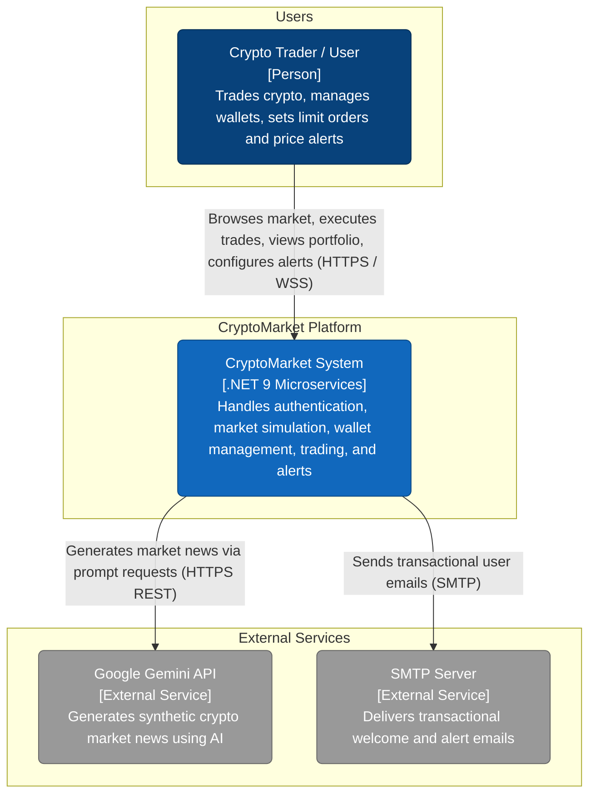

# System Context (C4 Level 1)

> High-level view of the CryptoMarket platform and its interactions with human users and external systems.

---

## Context Diagram

The CryptoMarket platform provides cryptocurrency trading simulation, portfolio tracking, limit order automation, AI-driven market news generation, and real-time push alerts.

*Last verified against commit: `b5229aa`*

---

## External Systems & Actors

| Actor / System | Type | Role & Interaction Description |
|---|---|---|
| **Crypto Trader / User** | Human Actor | Interacts with the platform via Web UI (Vue 3) or Mobile Client (Flutter) through the API Gateway. Authenticates via JWT, monitors real-time prices, manages asset holdings, executes trades, places limit orders, and receives live notifications. |
| **Google Gemini API** | External System | REST API invoked by `Market.API` (`GeminiService`) to dynamically generate crypto market news articles based on current market dynamics. |
| **SMTP Server** | External System | Mail server used by `Notifications.API` (`EmailService`) to send welcome emails upon account registration. |

---

## Next Steps

- For container-level decomposition, see [Containers (C4 Level 2)](containers.md).
- For local execution setup, see [Running Locally](../operations/running-locally.md).

---

## Sources

- `CRYPTOMARKET_DOCS_IMPLEMENTATION_PLAN.md` — Phase 2
- `docs/_inventory.md` — Section 1 (Services) & Section 6 (Service-to-service HTTP calls)
- `README.md` — Architecture Overview
