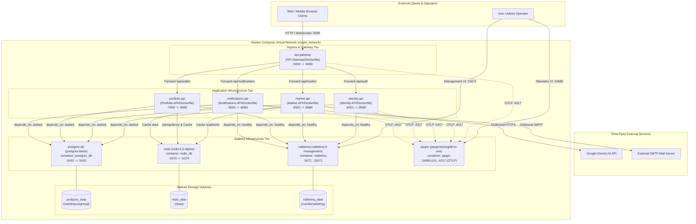

# Deployment Diagram

> Containerized topology, port mappings, network routing, persistent volumes, service dependencies, and environment configuration derived from `docker-compose.yml`.

---

## Deployment Topology Diagram

---

## Container Specifications and Environment Variables

The table below lists every container defined in `docker-compose.yml`, its build origin, published ports, startup dependencies, and required environment variables:

| Container / Service | Image / Build Context | Host : Container Ports | Dependencies (`depends_on`) | Required Environment Variable Names | Storage Volume |
|---|---|---|---|---|---|
| `api.gateway` | `API.Gateway/Dockerfile` | `5000:8080` | None | `OTEL_EXPORTER_OTLP_ENDPOINT` | None |
| `identity.api` | `Identity.API/Dockerfile` | `8001:8080` | `rabbitmq` (service_healthy), `postgres.db` (service_started) | `RabbitMQ__Host`, `RabbitMQ__Username`, `RabbitMQ__Password`, `Jwt__Key`, `OTEL_EXPORTER_OTLP_ENDPOINT`, `ConnectionStrings__DefaultConnection` | None |
| `market.api` | `Market.API/Dockerfile` | `8002:8080` | `rabbitmq` (service_healthy), `postgres.db` (service_started) | `RabbitMQ__Host`, `RabbitMQ__Username`, `RabbitMQ__Password`, `Jwt__Key`, `Gemini__ApiKey`, `OTEL_EXPORTER_OTLP_ENDPOINT`, `Redis__ConnectionString`, `ConnectionStrings__DefaultConnection` | None |
| `notifications.api` | `Notifications.API/Dockerfile` | `6000:8080` | `rabbitmq` (service_healthy), `postgres.db` (service_started) | `RabbitMQ__Host`, `RabbitMQ__Username`, `RabbitMQ__Password`, `Jwt__Key`, `EmailSettings__Password`, `Redis__ConnectionString`, `ConnectionStrings__DefaultConnection`, `OTEL_EXPORTER_OTLP_ENDPOINT` | None |
| `portfolio.api` | `Portfolio.API/Dockerfile` | `7000:8080` | `rabbitmq` (service_healthy), `postgres.db` (service_started) | `RabbitMQ__Host`, `RabbitMQ__Username`, `RabbitMQ__Password`, `ConnectionStrings__DefaultConnection`, `Redis__ConnectionString`, `Jwt__Key`, `OTEL_EXPORTER_OTLP_ENDPOINT` | None |
| `postgres.db` | `postgres:latest` (`postgres_db`) | `5432:5432` | None | `POSTGRES_USER`, `POSTGRES_PASSWORD`, `POSTGRES_DB`, `Jwt__Key` | `postgres_data:/var/lib/postgresql` |
| `redis` | `redis:6.2-alpine` (`redis_db`) | `6379:6379` | None | `REDIS_DATABASE`, `REDIS_USERNAME`, `REDIS_PASSWORD`, `Jwt__Key`, `Redis__ConnectionString` | `redis_data:/data` |
| `rabbitmq` | `rabbitmq:3-management` (`rabbitmq`) | `5672:5672`, `15672:15672` | None (Healthcheck: `rabbitmq-diagnostics -q ping`) | `RabbitMQ__Host` | `rabbitmq_data:/var/lib/rabbitmq` |
| `jaeger` | `jaegertracing/all-in-one:latest` (`jaeger`) | `16686:16686`, `4317:4317` | None | `COLLECTOR_OTLP_ENABLED` | None |

---

## Network and Startup Topology

1. **Virtual Network Isolation:** All services communicate within Docker Compose's shared internal bridge network (`crypto_network`). Internal services reference hostnames matching container names (`postgres.db`, `redis_db`, `rabbitmq`, `jaeger`).
2. **Healthcheck Orchestration:** Microservices declare conditional dependencies on RabbitMQ health (`condition: service_healthy`). The healthcheck executes `rabbitmq-diagnostics -q ping` with an interval of 5s and timeout of 15s to ensure the broker is operational before consumers bind queues.
3. **OpenTelemetry Telemetry:** All 5 ASP.NET Core applications push distributed trace data via gRPC OTLP exporter to `jaeger:4317`. Operators inspect trace graphs via the Jaeger UI at `http://localhost:16686`.
4. **Volume Persistence:** Data across database restarts is preserved using named volumes for PostgreSQL (`postgres_data`), Redis persistence snapshots (`redis_data`), and RabbitMQ queues and message state (`rabbitmq_data`).

---

## Sources

- [docker-compose.yml](file:///c:/CryptoMarketProject/backend/docker-compose.yml#L1-L162) — Complete Docker Compose orchestration definition.
- [API.Gateway/Dockerfile](file:///c:/CryptoMarketProject/backend/API.Gateway/Dockerfile) — Gateway container build context.
- [Identity.API/Dockerfile](file:///c:/CryptoMarketProject/backend/Identity.API/Dockerfile) — Identity container build context.
- [Market.API/Dockerfile](file:///c:/CryptoMarketProject/backend/Market.API/Dockerfile) — Market container build context.
- [Notifications.API/Dockerfile](file:///c:/CryptoMarketProject/backend/Notifications.API/Dockerfile) — Notifications container build context.
- [Portfolio.API/Dockerfile](file:///c:/CryptoMarketProject/backend/Portfolio.API/Dockerfile) — Portfolio container build context.
