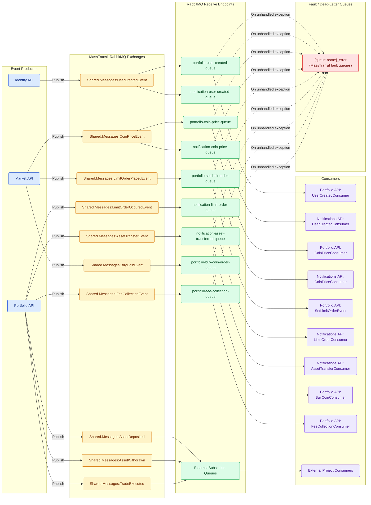

# Messaging Topology

> Message broker topology for MassTransit over RabbitMQ: producers, exchanges, queues, consumer subscriptions, and fault queues.

---

## Topology Diagram

The platform utilizes MassTransit publish-subscribe messaging over RabbitMQ. By convention, MassTransit generates fanout topic exchanges named after the fully qualified .NET message contract type, which are then bound to named consumer queues.

*Solid lines represent happy-path message routing; dashed lines represent fault routing to MassTransit error queues upon unhandled exceptions.*

---

## Topology Rules & Conventions

1. **Exchange Naming:** MassTransit automatically names RabbitMQ exchanges after the fully qualified CLR type of the message contract:
   - Pattern: `<Namespace>:<TypeName>` (e.g. `Shared.Messages:CoinPriceEvent`).
2. **Exchange Type:** All published message contracts are declared as `fanout` topic exchanges in RabbitMQ. If multiple queues bind to the exchange (e.g., both Portfolio and Notifications bind to `UserCreatedEvent` and `CoinPriceEvent`), each queue receives a dedicated copy of the message.
3. **Queue Naming:** Endpoints are configured explicitly in `Program.cs` via `cfg.ReceiveEndpoint("kebab-case-queue-name", ...)` to ensure predictable queue names across environments.
4. **Fault & Error Queues:**
   - When a consumer throws an unhandled exception, MassTransit catches the error and moves the original message along with exception details to a dead-letter queue named `[queue-name]_error`.
   - Examples: `portfolio-set-limit-order-queue_error`, `notification-limit-order-queue_error`.
5. **External Subscriptions:** `AssetDeposited`, `AssetWithdrawn`, and `TradeExecuted` are published to the broker for consumption by downstream services external to this repository.

---

## Sources

- `Shared.Messages/*.cs`
- `Identity.API/Program.cs`
- `Market.API/Program.cs`
- `Portfolio.API/Program.cs`
- `Notifications.API/Program.cs`
- `docs/events.md`
- `docs/_inventory.md` — Section 4 (RabbitMQ Messaging)
