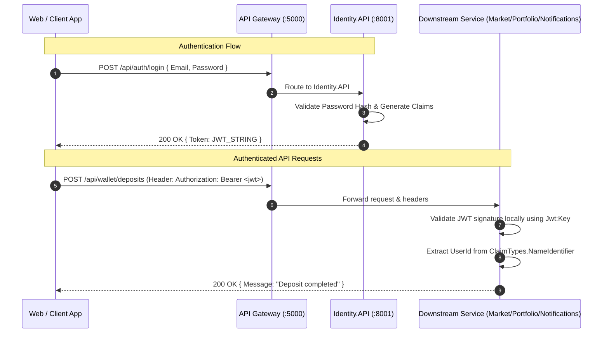

# Security Architecture & Authentication

> Comprehensive reference on identity issuance, JWT validation, claims propagation, SignalR WebSocket authentication, and cross-service security guarantees.

---

## 1. Security Overview & Trust Boundary

In CryptoMarket, user identity and authentication are centralized within `Identity.API`, while downstream microservices (`Market.API`, `Portfolio.API`, `Notifications.API`) perform local, stateless JWT signature validation using a shared symmetric secret key.



---

## 2. JWT Configuration & Shared Claims

All microservices configure the `Microsoft.AspNetCore.Authentication.JwtBearer` handler in `Program.cs` with identical token validation parameters:

| Configuration Key | Purpose / Description | Expected Environment Value |
|---|---|---|
| `Jwt:Key` | Symmetric HS256 secret signing key (minimum 32 characters) | Injected via `JWT_SECRET_KEY` in `.env` |
| `Jwt:Issuer` | Token issuer identifier | `IdentityAPI` |
| `Jwt:Audience` | Token intended audience | `CryptoAppUsers` |
| `Jwt:ExpireMinutes` | Token validity duration | `120` (2 hours) |

### Claims Payload Structure
When a user authenticates via `/api/auth/login`, `TokenService` in `Identity.API` issues a JWT containing the following claims:
- `ClaimTypes.NameIdentifier` (`sub`): User's unique `Guid` identifier.
- `ClaimTypes.Email`: User's registered email address.
- `ClaimTypes.Name`: Username string.
- `JwtRegisteredClaimNames.Jti`: Unique token GUID identifier.

### Local Token Validation
Downstream services do **not** invoke `Identity.API` over the network to validate tokens. Instead, each service validates the token cryptographically using the shared signing key. The `ValidateIssuer`, `ValidateAudience`, `ValidateLifetime`, and `ValidateIssuerSigningKey` flags are all set to `true`.

---

## 3. Deriving Identity: The "No Client-Supplied UserId" Rule

In compliance with [ADR 0007: User identity is always derived from the JWT](../decisions/0007-jwt-identity.md):
- Every user-scoped controller action extracts the caller's identity via:
  ```csharp
  var userId = User.FindFirstValue(ClaimTypes.NameIdentifier);
  ```
- If the claim is missing, invalid, or unparseable, endpoints immediately return `401 Unauthorized` (`"Invalid or broken token."`).
- No endpoint accepts `userId` in query parameters or routes for user-scoped mutation or queries.
- Public endpoints (coin quotes, market tickers, news feeds) run with anonymous access.

---

## 4. SignalR WebSocket Authentication

SignalR connections initiate with an HTTP handshake before upgrading to WebSockets. Standard browser WebSocket APIs do not support setting custom `Authorization` HTTP headers.

To authenticate WebSocket connections, `Notifications.API` and `Portfolio.API` configure the `OnMessageReceived` JWT bearer event in `Program.cs`:

```csharp
options.Events = new JwtBearerEvents
{
    OnMessageReceived = context =>
    {
        var accessToken = context.Request.Query["access_token"];
        var path = context.HttpContext.Request.Path;
        if (!string.IsNullOrEmpty(accessToken) && 
            (path.StartsWithSegments("/hubs/notifications") || path.StartsWithSegments("/hubs/portfolio")))
        {
            context.Token = accessToken;
        }
        return Task.CompletedTask;
    }
};
```

Clients establish authenticated real-time sessions using:
- `ws://localhost:5000/hubs/notifications?access_token=<jwt>`
- `ws://localhost:5000/hubs/portfolio?access_token=<jwt>`

---

## 5. User Identity in Asynchronous Message Consumers

When actions initiate asynchronous background processing, the originating HTTP endpoint extracts `userId` from the JWT and places it explicitly in the strongly-typed message contract payload:
- `UserCreatedEvent.UserId`: Published by `Identity.API` upon registration.
- `LimitOrderPlacedEvent.UserId`: Extracted from JWT by `MarketController` and embedded in the event payload dispatched to `Portfolio.API`.
- `LimitOrderOccuredEvent.UserId`: Forwarded by `LimitOrderService` to `Notifications.API`.

Downstream consumers (`IConsumer<T>`) extract the user identifier directly from the message payload (`context.Message.UserId`).

---

## 6. Key Rotation & Secret Management

- **Development:** Symmetric secret keys are configured in `.env` (`JWT_SECRET_KEY`) and read into `appsettings.json` via environment variable substitution.
- **Production Guidance:** Secret keys must be provisioned through secure secret stores (e.g., HashiCorp Vault, AWS Secrets Manager, Azure Key Vault). 
- **Rotation Behavior:** Because tokens are signed with symmetric HS256 keys, updating `Jwt:Key` immediately invalidates all active sessions. To rotate keys without disconnecting users, deploy dual-key validation or short-lived token lifetimes before rotating secrets.

---

## Sources

- [Identity.API/Application/Services/TokenService.cs](file:///c:/CryptoMarketProject/backend/Identity.API/Application/Services/TokenService.cs)
- [Identity.API/Controllers/AuthController.cs](file:///c:/CryptoMarketProject/backend/Identity.API/Controllers/AuthController.cs)
- [Portfolio.API/Program.cs](file:///c:/CryptoMarketProject/backend/Portfolio.API/Program.cs#L36-L55)
- [Notifications.API/Program.cs](file:///c:/CryptoMarketProject/backend/Notifications.API/Program.cs#L26-L45)
- [Market.API/Program.cs](file:///c:/CryptoMarketProject/backend/Market.API/Program.cs#L26-L45)
- [docs/decisions/0007-jwt-identity.md](file:///c:/CryptoMarketProject/backend/docs/decisions/0007-jwt-identity.md)
