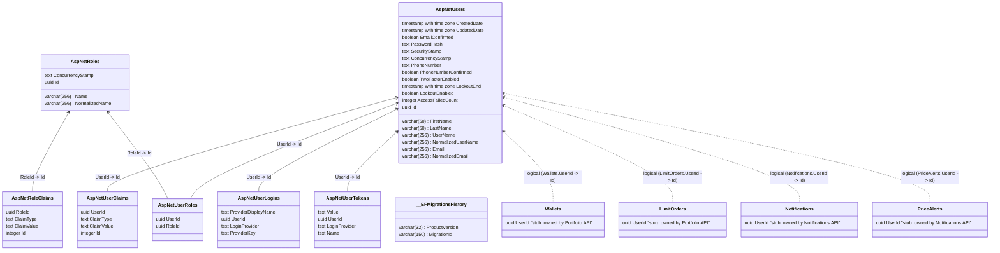

# Identity Database (IdentityDb)

> Database schema for Identity.API managing users, roles, and ASP.NET Core Identity security claims.

---

## Entity Relationship Diagram

The diagram below contains the raw schema generated from DataGrip with physical foreign keys, alongside manual overlay stubs indicating which external services reference `AspNetUsers`.

*Solid arrows (`-->`) denote physical database foreign keys; dashed arrows (`..>`) denote logical cross-service references.*

---

## Constraints, Indexes & Defaults

| Table | Constraint / Index Name | Type | Column(s) | Description | Configuration Source |
|---|---|---|---|---|---|
| `AspNetUsers` | `UserNameIndex` | Unique Index | `NormalizedUserName` | Guarantees username uniqueness | `Identity.API/Migrations/...ModelSnapshot.cs` |
| `AspNetUsers` | `EmailIndex` | Unique Index | `NormalizedEmail` | Guarantees email uniqueness | `Identity.API/Migrations/...ModelSnapshot.cs` |
| `AspNetUsers` | `FirstName` | Column Constraint | `FirstName` | Required, max length 50 | `Identity.API/Infrastructure/Configurations/UserConfiguration.cs` |
| `AspNetUsers` | `LastName` | Column Constraint | `LastName` | Required, max length 50 | `Identity.API/Infrastructure/Configurations/UserConfiguration.cs` |
| `AspNetUsers` | `CreatedDate` | Column Constraint | `CreatedDate` | Required timestamp | `Identity.API/Infrastructure/Configurations/UserConfiguration.cs` |
| `AspNetRoles` | `RoleNameIndex` | Unique Index | `NormalizedName` | Guarantees role name uniqueness | `Identity.API/Migrations/...ModelSnapshot.cs` |

---

## Logical Cross-Service References

`AspNetUsers.Id` serves as the primary user identity token across the entire microservices architecture. It is referenced logically without physical foreign keys by:

| Referencing Service | Referencing Table & Column | Cardinality | Consistency Mechanism | If User Deleted |
|---|---|---|---|---|
| `Portfolio.API` | `Wallets.UserId` | 1:1 | Created asynchronously via `UserCreatedEvent` on registration | Orphaned wallet |
| `Portfolio.API` | `LimitOrders.UserId` | 1:N | Derived from authenticated JWT claims | Orphaned limit orders |
| `Notifications.API` | `Notifications.UserId` | 1:N | Set during notification creation from event payloads | Orphaned notifications |
| `Notifications.API` | `PriceAlerts.UserId` | 1:N | Derived from authenticated JWT claims | Orphaned alerts |

---

## Sources

- `Identity.API/Infrastructure/Context/ApplicationDbContext.cs`
- `Identity.API/Infrastructure/Configurations/UserConfiguration.cs`
- `Identity.API/Migrations/ApplicationDbContextModelSnapshot.cs`
- `docs/database/generated/identity.mmd`
- `docs/_inventory.md` — Section 2 (Databases)
