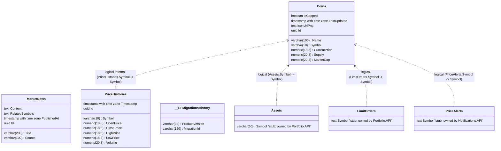

# Market Database (MarketDb)

> Database schema for Market.API managing cryptocurrency coins, market news articles, and price history candlesticks.

---

## Entity Relationship Diagram

The diagram below contains the raw schema generated from DataGrip alongside the manual overlay stubs indicating internal logical references and external dependencies.

*Solid arrows (`-->`) denote physical database foreign keys; dashed arrows (`..>`) denote logical references without physical constraints.*

---

## Constraints, Indexes & Defaults

| Table | Constraint / Index Name | Type | Column(s) | Description | Configuration Source |
|---|---|---|---|---|---|
| `Coins` | `IX_Coins_Symbol` | Unique Index | `Symbol` | Enforces unique coin symbols (e.g. BTC, ETH) | `Market.API/Infrastructure/Configurations/CoinConfiguration.cs` |
| `Coins` | `Name` | Column Constraint | `Name` | Required, max length 100 | `Market.API/Infrastructure/Configurations/CoinConfiguration.cs` |
| `Coins` | `CurrentPrice` | Precision | `CurrentPrice` | `numeric(18,8)` | `Market.API/Infrastructure/Configurations/CoinConfiguration.cs` |
| `Coins` | `Supply` | Precision | `Supply` | `numeric(20,8)` | `Market.API/Infrastructure/Configurations/CoinConfiguration.cs` |
| `Coins` | `MarketCap` | Precision | `MarketCap` | `numeric(20,2)` | `Market.API/Infrastructure/Configurations/CoinConfiguration.cs` |
| `PriceHistories` | `IX_PriceHistories_Symbol_Timestamp` | Unique Index | `(Symbol, Timestamp)` | Composite uniqueness per coin candlestick bucket | `Market.API/Infrastructure/Configurations/PriceHistoryConfiguration.cs` |
| `PriceHistories` | `Open/Close/High/Low` | Precision | Prices | `numeric(18,8)` | `Market.API/Infrastructure/Configurations/PriceHistoryConfiguration.cs` |
| `MarketNews` | `IX_MarketNews_PublishedAt` | B-Tree Index | `PublishedAt` | Chronological sorting index for news feeds | `Market.API/Infrastructure/Configurations/MarketNewsConfiguration.cs` |
| `MarketNews` | `Title` | Column Constraint | `Title` | Required, max length 200 | `Market.API/Infrastructure/Configurations/MarketNewsConfiguration.cs` |
| `MarketNews` | `RelatedSymbols` | Conversion | `RelatedSymbols` | Stored as comma-separated string, converted to `List<string>` | `Market.API/Infrastructure/Configurations/MarketNewsConfiguration.cs` |

---

## Logical Cross-Service & Internal References

`Coins.Symbol` is the master identifier for all traded cryptocurrencies. It is referenced across services without physical FK constraints:

| Referencing Service | Referencing Table & Column | Cardinality | Consistency Mechanism | If Coin Deleted |
|---|---|---|---|---|
| `Market.API` *(Internal)* | `PriceHistories.Symbol` | 1:N | Periodic aggregation from `PriceHistoryGenerator` | Orphaned historical price records |
| `Portfolio.API` | `Assets.Symbol` | 1:N | Validated during trade execution in `WalletService` | Orphaned asset balance symbol |
| `Portfolio.API` | `LimitOrders.Symbol` | 1:N | Validated against market during limit order creation | Order remains pending forever |
| `Portfolio.API` | `Transactions.Symbol` | 1:N | Recorded from executed trade operation | Historical audit record retained |
| `Portfolio.API` | `TreasuryBalances.AssetSymbol`| 1:1 | Accumulated platform fees collected in asset currency | Accumulated fee retained |
| `Notifications.API` | `PriceAlerts.Symbol` | 1:N | Matched against `CoinPriceEvent.Symbol` in consumer | Alert never triggers |

---

## Migration Note

`MarketDb` originally ran on MongoDB and was migrated to PostgreSQL on 2026-07-10. See [ADR 0002](../decisions/0002-marketdb-mongodb-to-postgresql.md) for rationale and commit history.

---

## Sources

- `Market.API/Infrastructure/Context/ApplicationDbContext.cs`
- `Market.API/Infrastructure/Configurations/CoinConfiguration.cs`
- `Market.API/Infrastructure/Configurations/MarketNewsConfiguration.cs`
- `Market.API/Infrastructure/Configurations/PriceHistoryConfiguration.cs`
- `docs/database/generated/market.mmd`
- `docs/_inventory.md` — Section 2 (Databases) & Section 9 (Git History Evidence)
