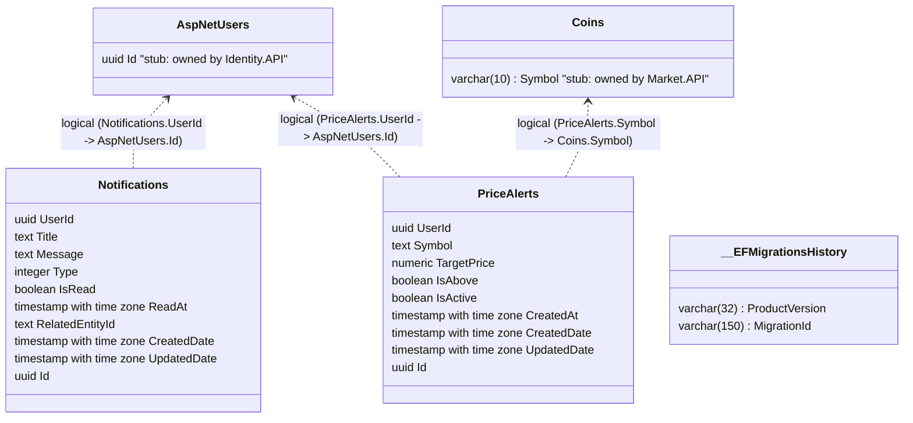

# Notifications Database (NotificationsDb)

> Database schema for Notifications.API managing in-app push notifications and user price alerts.

---

## Entity Relationship Diagram

The diagram below contains the raw schema generated from DataGrip alongside the manual overlay stubs indicating logical cross-service relationships to `IdentityDb` and `MarketDb`.

*Solid arrows (`-->`) denote physical database foreign keys; dashed arrows (`..>`) denote logical cross-service references.*

---

## Constraints, Indexes & Defaults

| Table | Constraint / Index Name | Type | Column(s) | Description | Configuration Source |
|---|---|---|---|---|---|
| `Notifications` | `PK_Notifications` | Primary Key | `Id` | Auto-generated UUID (`Guid.NewGuid()`) | `Notifications.API/Domain/Entities/BaseEntity.cs` |
| `Notifications` | `UserId`, `Title`, `Message` | Validation | Columns | Enforced in domain constructor | `Notifications.API/Domain/Entities/Notification.cs` |
| `Notifications` | `IsRead` | State Flag | `IsRead` | Defaults to `false`, toggled via `MarkAsRead()` | `Notifications.API/Domain/Entities/Notification.cs` |
| `PriceAlerts` | `PK_PriceAlerts` | Primary Key | `Id` | Auto-generated UUID (`Guid.NewGuid()`) | `Notifications.API/Domain/Entities/BaseEntity.cs` |
| `PriceAlerts` | `UserId`, `Symbol`, `TargetPrice` | Validation | Columns | Enforced in domain constructor (`TargetPrice > 0`) | `Notifications.API/Domain/Entities/PriceAlert.cs` |
| `PriceAlerts` | `IsActive` | State Flag | `IsActive` | Defaults to `true`, toggled via `Deactivate()` | `Notifications.API/Domain/Entities/PriceAlert.cs` |

---

## Logical Cross-Service References

| Local Table & Column | Target Service & Entity | Cardinality | Consistency Mechanism | If Target Deleted |
|---|---|---|---|---|
| `Notifications.UserId` | `Identity.API: AspNetUsers.Id` | 1:N | Set during notification creation from event payloads or direct requests | Orphaned notification |
| `PriceAlerts.UserId` | `Identity.API: AspNetUsers.Id` | 1:N | Derived from authenticated JWT claims | Orphaned alert |
| `PriceAlerts.Symbol` | `Market.API: Coins.Symbol` | 1:N | Evaluated against `CoinPriceEvent.Symbol` received from RabbitMQ | Alert never triggers |

---

## Sources

- `Notifications.API/Infrastructure/Context/ApplicationDbContext.cs`
- `Notifications.API/Domain/Entities/Notification.cs`
- `Notifications.API/Domain/Entities/PriceAlert.cs`
- `docs/database/generated/notifications.mmd`
- `docs/_inventory.md` — Section 2 (Databases)
