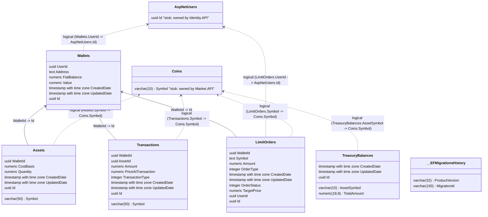

# Portfolio Database (PortfolioDb)

> Database schema for Portfolio.API managing user wallets, crypto asset holdings, transaction history, limit orders, and platform treasury balances.

---

## Entity Relationship Diagram

The diagram below contains the raw schema generated from DataGrip with physical foreign keys, alongside manual overlay stubs indicating logical cross-service relationships to `IdentityDb` and `MarketDb`.

*Solid arrows (`-->`) denote physical database foreign keys; dashed arrows (`..>`) denote logical cross-service references.*

---

## Constraints, Indexes & Defaults

| Table | Constraint / Index Name | Type | Column(s) | Description | Configuration Source |
|---|---|---|---|---|---|
| `Wallets` | `IX_Wallets_UserId` | Unique Index | `UserId` | Enforces one wallet per registered user | `Portfolio.API/Infrastructure/Configurations/WalletConfiguration.cs` |
| `Wallets` | `Address` | Column Constraint | `Address` | Required generated hexadecimal address | `Portfolio.API/Infrastructure/Configurations/WalletConfiguration.cs` |
| `Wallets` | `FiatBalance` | Default Value | `FiatBalance` | Defaults to `0`, required numeric | `Portfolio.API/Infrastructure/Configurations/WalletConfiguration.cs` |
| `Assets` | `FK_Assets_Wallets_WalletId` | Foreign Key | `WalletId` | Restricts wallet deletion if assets exist (`DeleteBehavior.Restrict`) | `Portfolio.API/Infrastructure/Configurations/WalletConfiguration.cs` |
| `Assets` | `Symbol` | Column Constraint | `Symbol` | Required, max length 50 | `Portfolio.API/Infrastructure/Configurations/AssetConfiguration.cs` |
| `LimitOrders` | `FK_LimitOrders_Wallets_WalletId`| Foreign Key | `WalletId` | Linked wallet foreign key (`DeleteBehavior.NoAction`) | `Portfolio.API/Infrastructure/Configurations/LimitOrderConfiguration.cs` |
| `LimitOrders` | `Symbol`, `Amount`, `TargetPrice`| Column Constraint | Columns | Required order parameters | `Portfolio.API/Infrastructure/Configurations/LimitOrderConfiguration.cs` |
| `Transactions` | `FK_Transactions_Wallets_WalletId`| Foreign Key | `WalletId` | Restricts wallet deletion if transactions exist (`DeleteBehavior.Restrict`) | `Portfolio.API/Infrastructure/Configurations/WalletConfiguration.cs` |
| `TreasuryBalances`| `AssetSymbol` | Column Constraint | `AssetSymbol` | Required, max length 10 | `Portfolio.API/Infrastructure/Configurations/TreasuryBalanceConfiguration.cs` |
| `TreasuryBalances`| `TotalAmount` | Precision | `TotalAmount` | `decimal(18,8)` | `Portfolio.API/Infrastructure/Configurations/TreasuryBalanceConfiguration.cs` |

---

## Logical Cross-Service References

| Local Table & Column | Target Service & Entity | Cardinality | Consistency Mechanism | If Target Deleted |
|---|---|---|---|---|
| `Wallets.UserId` | `Identity.API: AspNetUsers.Id` | 1:1 | Created asynchronously upon receiving `UserCreatedEvent` | Orphaned wallet |
| `LimitOrders.UserId` | `Identity.API: AspNetUsers.Id` | 1:N | Derived from authenticated JWT claims | Orphaned order |
| `Assets.Symbol` | `Market.API: Coins.Symbol` | 1:N | Validated during purchase/deposit against active coins | Orphaned asset balance |
| `LimitOrders.Symbol` | `Market.API: Coins.Symbol` | 1:N | Validated against market coins during order creation | Order will never match |
| `Transactions.Symbol` | `Market.API: Coins.Symbol` | 1:N | Recorded from executed trade operation | Historical audit log retained |
| `TreasuryBalances.AssetSymbol` | `Market.API: Coins.Symbol` | 1:1 | Accumulated platform fee currency | Fee balance retained |

---

## Sources

- `Portfolio.API/Infrastructure/Context/ApplicationDbContext.cs`
- `Portfolio.API/Infrastructure/Configurations/WalletConfiguration.cs`
- `Portfolio.API/Infrastructure/Configurations/AssetConfiguration.cs`
- `Portfolio.API/Infrastructure/Configurations/LimitOrderConfiguration.cs`
- `Portfolio.API/Infrastructure/Configurations/TransactionConfiguration.cs`
- `Portfolio.API/Infrastructure/Configurations/TreasuryBalanceConfiguration.cs`
- `docs/database/generated/portfolio.mmd`
- `docs/_inventory.md` — Section 2 (Databases)
