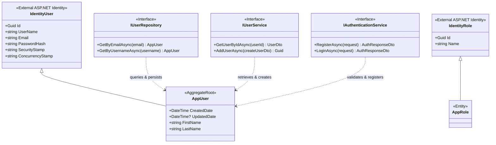

# Identity Service Domain Model

> Domain class diagram for `Identity.API`, representing user identity, roles, authentication services, repository abstractions, and JWT token issuance.

---

## Class Diagram

---

## Domain Architecture and Invariants

### 1. User Aggregate Root (`AppUser`)
- Inherits from ASP.NET Core Identity `IdentityUser<Guid>`.
- **Unique Credentials:** Enforced via normalized unique indexes on `NormalizedUserName` and `NormalizedEmail`.
- **Audit Timestamps:** Tracks `CreatedDate` (defaulting to current timestamp) and `UpdatedDate`.
- **Profile Data:** Stores `FirstName` and `LastName`.

### 2. Services and Asynchronous Events
- **`IAuthenticationService`:** Handles credential validation, password hashing, and returns signed JWT tokens.
- **`IUserService` / `UserService`:** Orchestrates user registration and publishes `UserCreatedEvent` to RabbitMQ via MassTransit, allowing downstream services (`Portfolio.API`, `Notifications.API`) to initialize user wallets and trigger welcome notifications asynchronously.

---

## Sources

- [AppUser.cs](file:///c:/CryptoMarketProject/backend/Identity.API/Domain/Entities/AppUser.cs#L5-L12) — User entity definition.
- [AppRole.cs](file:///c:/CryptoMarketProject/backend/Identity.API/Domain/Entities/AppRole.cs#L5-L6) — Role entity definition.
- [IUserRepository.cs](file:///c:/CryptoMarketProject/backend/Identity.API/Domain/Interfaces/IUserRepository.cs#L5-L9) — User repository abstraction.
- [IAuthenticationService.cs](file:///c:/CryptoMarketProject/backend/Identity.API/Application/Interfaces/IAuthenticationService.cs#L5-L9) — Authentication service interface.
- [IUserService.cs](file:///c:/CryptoMarketProject/backend/Identity.API/Application/Interfaces/IUserService.cs#L6-L10) — User management interface.
