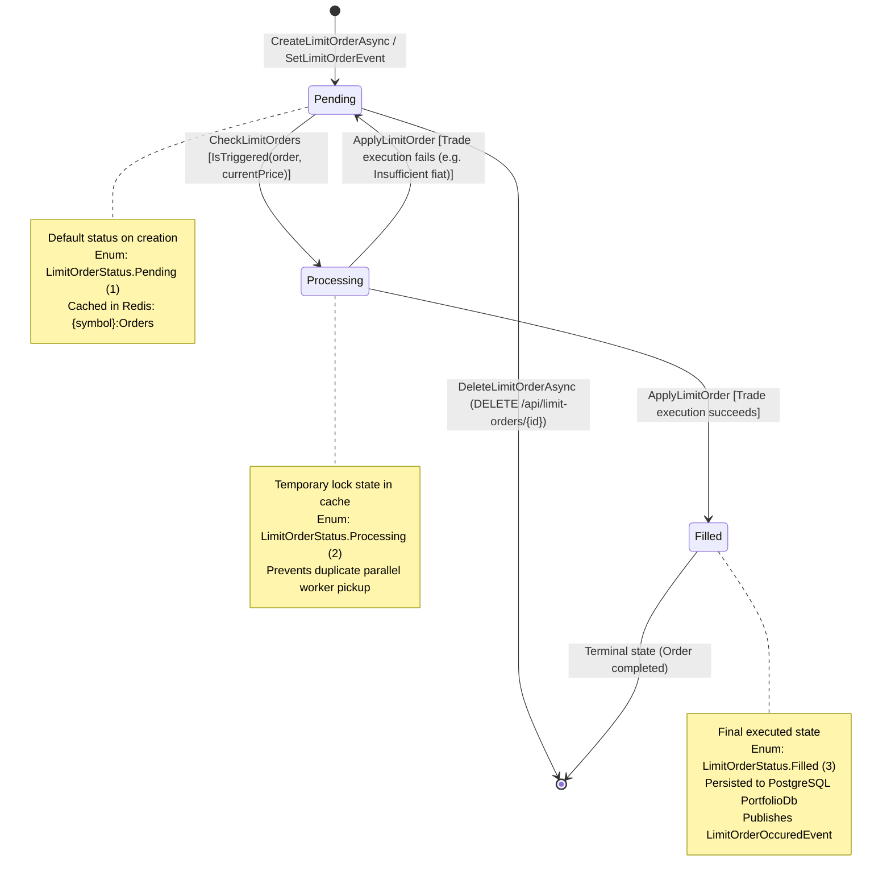

# Limit Order State Machine

> Lifecycle state machine for the `LimitOrder` entity in `Portfolio.API`, documenting state transitions, triggering events, guard conditions, and persistence side effects.

---

## State Diagram

---

## State Transition Table

| Source State | Target State | Triggering Event / Method | Guard Conditions | Side Effects & Actions | Source |
|---|---|---|---|---|---|
| `[*] (None)` | `Pending` (1) | `LimitOrderService.CreateLimitOrderAsync` | `orderDto != null`, CorrelationId not present in Redis (`cacheService.GetAsync<string> == null`) | Entity saved to PostgreSQL `PortfolioDb` via `LimitOrderRepository.AddAsync`. CorrelationId stored in Redis for 24h. Redis cache `{symbol}Orders` invalidated. | [LimitOrderService.cs](file:///c:/CryptoMarketProject/backend/Portfolio.API/Application/Services/LimitOrderService.cs#L69-L98) |
| `Pending` (1) | `Processing` (2) | `LimitOrderService.CheckLimitOrders` | Price tick matches target: `Buy: price <= TargetPrice` or `Sell: price >= TargetPrice` | In-memory status changed to `Processing`. Redis cache `{symbol}:Orders` refreshed to guard against duplicate parallel pickup. | [LimitOrderService.cs](file:///c:/CryptoMarketProject/backend/Portfolio.API/Application/Services/LimitOrderService.cs#L158-L175) |
| `Processing` (2) | `Filled` (3) | `LimitOrderService.ApplyLimitOrder` | Wallet has sufficient fiat/crypto balance (`FiatBalance >= totalCost` for Buy; `Asset.Quantity >= amount` for Sell) | Wallet balances adjusted. Transaction record logged. `LimitOrderOccuredEvent` published to MassTransit. Entity status updated to `Filled` in PostgreSQL via `LimitOrderRepository.UpdateAsync(id, Filled)`. | [LimitOrderService.cs](file:///c:/CryptoMarketProject/backend/Portfolio.API/Application/Services/LimitOrderService.cs#L19-L67) |
| `Processing` (2) | `Pending` (1) | `LimitOrderService.ApplyLimitOrder` (Failure) | `WalletService.BuyAsset` throws `ArgumentException` (e.g., `Error: Not Enough Money!`) | Order status in database is not updated to `Filled`. In-memory exception logs failure; order remains `Pending` in PostgreSQL for future ticks. | [LimitOrderService.cs](file:///c:/CryptoMarketProject/backend/Portfolio.API/Application/Services/LimitOrderService.cs#L46-L50) |
| `Pending` (1) | `[*] (Deleted)` | `LimitOrderService.DeleteLimitOrderAsync` | Order ID exists in database | HTTP `DELETE /api/limit-orders/{id}` invokes `LimitOrderRepository.DeleteAsync(limitOrderId)`, executing a hard delete `DELETE FROM "LimitOrders" WHERE "Id" = @id`. | [LimitOrderController.cs](file:///c:/CryptoMarketProject/backend/Portfolio.API/Controllers/LimitOrderController.cs#L66-L71) |

---

## Notable State Design Considerations

- **Canceled State Enum vs. Hard Deletion:** The enum `LimitOrderStatus.Canceled = 4` is defined in `LimitOrderStatus.cs`. However, current controller logic in `LimitOrderController.DeleteLimitOrder` performs an immediate hard delete through `LimitOrderRepository.DeleteAsync` rather than a soft-delete status update.
- **In-Memory Concurrency Protection:** Transitioning pending orders to `Processing` in the Redis cache before passing them to `Parallel.ForEachAsync` prevents re-entrant price ticks from triggering duplicate order applications while database queries are in flight.
- **Related Entity Lifecycle (Notification):** The `Notification` entity in `Notifications.API` represents the only other entity with explicit state transitions. It manages an `IsRead` boolean property (`false` on creation, transitioning to `true` when `Notification.MarkAsRead()` is called via `NotificationService.MarkAsReadAsync`).

---

## Sources

- [LimitOrderStatus.cs](file:///c:/CryptoMarketProject/backend/Portfolio.API/Domain/Enums/LimitOrderStatus.cs#L3-L9) — State enumeration definitions.
- [LimitOrder.cs](file:///c:/CryptoMarketProject/backend/Portfolio.API/Domain/Entities/LimitOrder.cs#L5-L15) — Domain entity definition and default `Pending` status.
- [LimitOrderService.cs](file:///c:/CryptoMarketProject/backend/Portfolio.API/Application/Services/LimitOrderService.cs#L19-L189) — Order matching, state transitions, and trade execution.
- [LimitOrderRepository.cs](file:///c:/CryptoMarketProject/backend/Portfolio.API/Infrastructure/Repositories/LimitOrderRepository.cs#L22-L28) — Status persistence in `PortfolioDb`.
- [LimitOrderController.cs](file:///c:/CryptoMarketProject/backend/Portfolio.API/Controllers/LimitOrderController.cs#L66-L71) — Deletion endpoint implementation.
