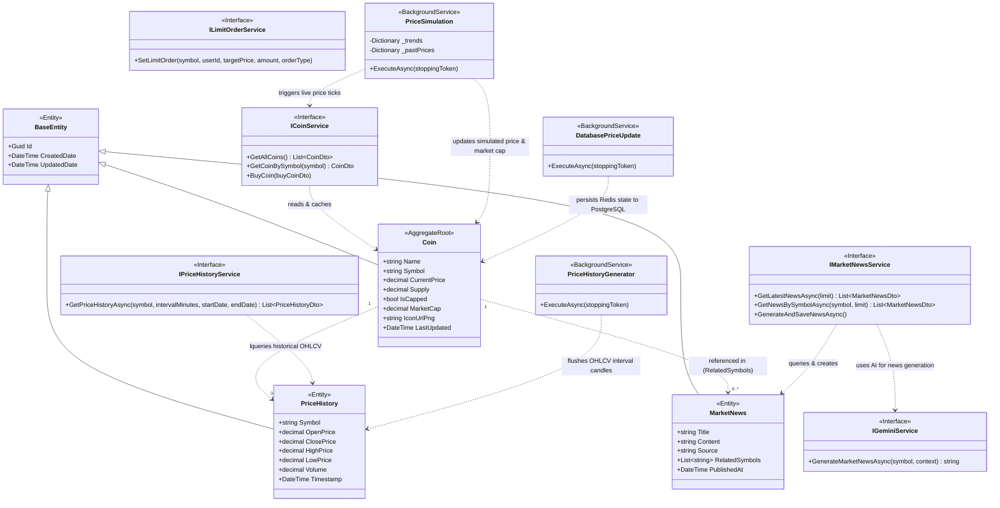

# Market Service Domain Model

> Domain class diagram for `Market.API`, representing market assets, price history tracking, generative news summaries, simulation engines, and external integration services.

---

## Class Diagram

---

## Domain Architecture and Invariants

### 1. Coin Entity as Market Anchor
The `Coin` entity acts as the central reference anchor for market operations:
- **Symbol Uniqueness:** Every coin possesses a unique ticker symbol (`BTC`, `ETH`, `SOL`), enforced by a unique database index (`IX_Coins_Symbol`).
- **Valuation Invariant:** `MarketCap = CurrentPrice * Supply`. When price ticks occur in `PriceSimulation`, the market capitalization is recomputed synchronously.
- **Fast Access & Invalidation:** Live coin listings are cached in Redis under `market:coins` (5-second read TTL; refreshed periodically by simulation ticks).

### 2. Time-Series and Historical Tracking
- **`PriceHistory`:** Captures candlestick snapshots (`OpenPrice`, `ClosePrice`, `HighPrice`, `LowPrice`, `Volume`, `Timestamp`).
- **Logical Association:** Relationship between `PriceHistory` and `Coin` is maintained via the string `Symbol` rather than a foreign key constraint to maintain lightweight time-series appending.
- **`PriceHistoryGenerator`:** Periodically samples moving prices, aggregates OHLCV metrics, and persists historical bars to PostgreSQL `MarketDb`.

### 3. AI Market Intelligence and News
- **`MarketNews` & `IGeminiService`:** Integrates Google Gemini API to generate synthetic market news and commentary based on current coin price volatility and momentum.
- **Symbol Linkage:** Stored in PostgreSQL with an array of affected coin tickers (`RelatedSymbols`), allowing filtered retrieval per asset.

---

## Sources

- [Coin.cs](file:///c:/CryptoMarketProject/backend/Market.API/Domain/Entities/Coin.cs#L3-L13) — Core coin entity.
- [PriceHistory.cs](file:///c:/CryptoMarketProject/backend/Market.API/Domain/Entities/PriceHistory.cs#L3-L12) — Time-series price history entity.
- [MarketNews.cs](file:///c:/CryptoMarketProject/backend/Market.API/Domain/Entities/MarketNews.cs#L3-L10) — Market news entity.
- [ICoinService.cs](file:///c:/CryptoMarketProject/backend/Market.API/Application/Interfaces/ICoinService.cs#L5-L10) — Coin retrieval and purchase interface.
- [IPriceHistoryService.cs](file:///c:/CryptoMarketProject/backend/Market.API/Application/Interfaces/IPriceHistoryService.cs#L5-L9) — Historical pricing interface.
- [IMarketNewsService.cs](file:///c:/CryptoMarketProject/backend/Market.API/Application/Interfaces/IMarketNewsService.cs#L5-L12) — Market news interface.
- [PriceSimulation.cs](file:///c:/CryptoMarketProject/backend/Market.API/Infrastructure/BackgroundServices/PriceSimulation.cs#L13-L92) — Price simulation background service.
