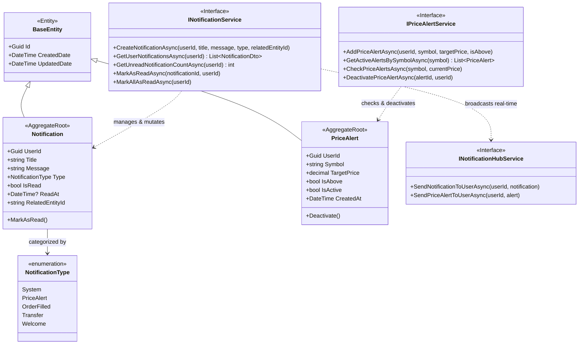

# Notifications Service Domain Model

> Domain class diagram for `Notifications.API`, representing notification dispatches, price alerts, SignalR real-time hubs, and domain services.

---

## Class Diagram

---

## Domain Architecture and Invariants

### 1. Notification Aggregate Root
- **Lifecycle:** Created with `IsRead = false`. Transition to read status occurs explicitly via `Notification.MarkAsRead()`, which stamps `ReadAt = DateTime.UtcNow`.
- **Classification:** Categorized by `NotificationType` enum (`System`, `PriceAlert`, `OrderFilled`, `Transfer`, `Welcome`).
- **Traceability:** Carries an optional `RelatedEntityId` to link back to the originating trade, order, or transfer.

### 2. PriceAlert Aggregate Root
- **Threshold Matching:** Configured with `TargetPrice` and directional boolean `IsAbove`. When incoming `CoinPriceEvent` ticks breach the target threshold, the alert triggers a user notification.
- **Single-Trigger Invariant:** Price alerts are deactivated upon matching via `PriceAlert.Deactivate()` (`IsActive = false`), preventing duplicate alert spam for oscillating prices.

---

## Sources

- [Notification.cs](file:///c:/CryptoMarketProject/backend/Notifications.API/Domain/Entities/Notification.cs#L5-L44) — Notification domain entity.
- [PriceAlert.cs](file:///c:/CryptoMarketProject/backend/Notifications.API/Domain/Entities/PriceAlert.cs#L5-L49) — PriceAlert domain entity.
- [NotificationType.cs](file:///c:/CryptoMarketProject/backend/Notifications.API/Domain/Enums/NotificationType.cs#L3-L10) — Notification types.
- [INotificationService.cs](file:///c:/CryptoMarketProject/backend/Notifications.API/Application/Interfaces/INotificationService.cs#L6-L14) — Notification service interface.
- [IPriceAlertService.cs](file:///c:/CryptoMarketProject/backend/Notifications.API/Application/Interfaces/IPriceAlertService.cs#L6-L13) — Price alert service interface.
- [INotificationHubService.cs](file:///c:/CryptoMarketProject/backend/Notifications.API/Application/Interfaces/INotificationHubService.cs#L6-L11) — Notification SignalR hub contract.

