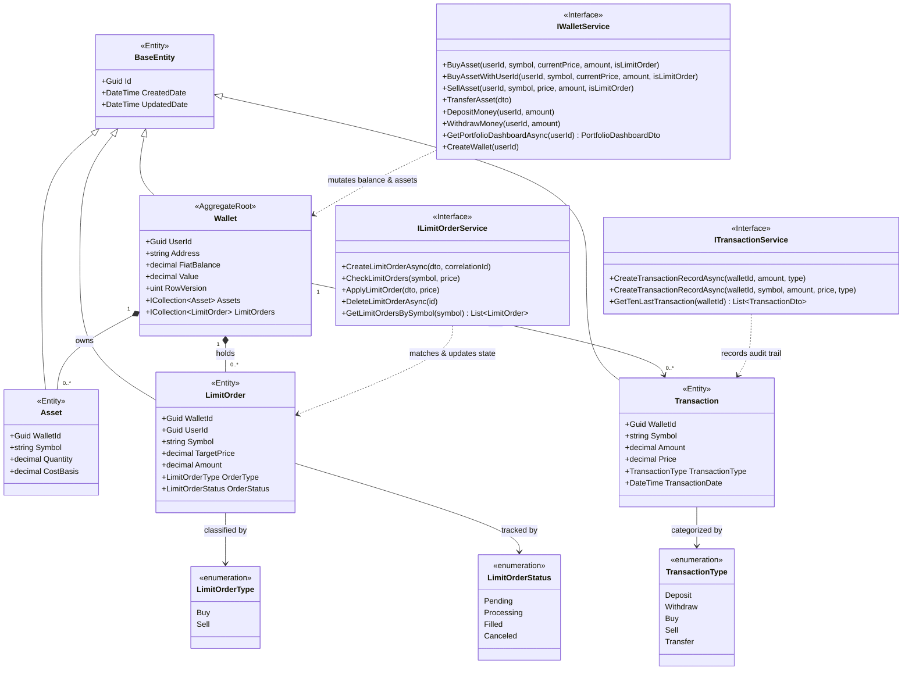

# Portfolio Service Domain Model

> Domain class diagram for `Portfolio.API`, representing the `Wallet` aggregate root, entity relationships, invariant-enforcing domain services, and repository abstractions.

---

## Class Diagram

---

## Domain Architecture and Invariants

### 1. The Wallet Aggregate Root
`Wallet` serves as the primary aggregate root within the Portfolio domain:
- **One Wallet per User:** Enforced by database unique constraint `IX_Wallets_UserId` and verified upon creation.
- **Child Asset Encapsulation:** Individual crypto balances (`Asset` entities) are owned by the `Wallet`. When an asset quantity drops to zero through sales or transfers, the `Asset` row is pruned by `WalletService`.
- **Concurrency Control:** The `RowVersion` uint column acts as an optimistic concurrency token to safeguard wallet balance modifications against race conditions during simultaneous deposit, withdrawal, and trade operations.

### 2. Domain Services and Invariant Enforcement
- **`WalletService`:** Enforces core financial invariants:
  - Total cost validation: `wallet.FiatBalance >= totalCost` for purchases.
  - Ownership validation: caller must own sufficient quantity of `Asset` before initiating sales or transfers.
  - Fee calculation: automatically applies `MakerFeeRate` for limit order executions and `TakerFeeRate` for immediate market purchases.
  - Double-entry transfer: debits sender, credits receiver, adjusts wallet valuations, and logs dual transaction records.
- **`LimitOrderService`:** Coordinates the price matching engine:
  - Enforces order uniqueness via Redis CorrelationId checks.
  - Manages concurrent evaluation of order execution via `Parallel.ForEachAsync`.
  - Publishes `LimitOrderOccuredEvent` upon filled order transitions.
- **`TransactionService`:** Maintains an immutable audit history of all money and crypto movements (`Deposit`, `Withdraw`, `Buy`, `Sell`, `Transfer`).

---

## Sources

- [Wallet.cs](file:///c:/CryptoMarketProject/backend/Portfolio.API/Domain/Entities/Wallet.cs#L5-L16) — Aggregate root entity.
- [Asset.cs](file:///c:/CryptoMarketProject/backend/Portfolio.API/Domain/Entities/Asset.cs#L5-L13) — Owned asset entity.
- [LimitOrder.cs](file:///c:/CryptoMarketProject/backend/Portfolio.API/Domain/Entities/LimitOrder.cs#L5-L15) — Limit order entity.
- [Transaction.cs](file:///c:/CryptoMarketProject/backend/Portfolio.API/Domain/Entities/Transaction.cs#L5-L15) — Financial transaction audit entity.
- [IWalletService.cs](file:///c:/CryptoMarketProject/backend/Portfolio.API/Application/Interfaces/IWalletService.cs#L8-L23) — Wallet service contract.
- [ILimitOrderService.cs](file:///c:/CryptoMarketProject/backend/Portfolio.API/Application/Interfaces/ILimitOrderService.cs#L7-L18) — Limit order service contract.
- [ITransactionService.cs](file:///c:/CryptoMarketProject/backend/Portfolio.API/Application/Interfaces/ITransactionService.cs#L6-L15) — Transaction service contract.
