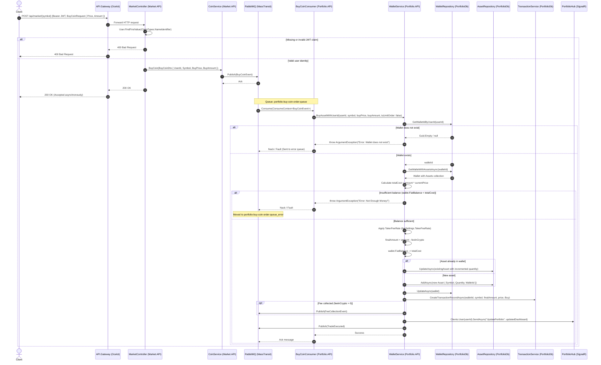

# Buy Coin Flow

> End-to-end purchasing flow showing asynchronous order submission via Market.API, validation, balance verification, taker fee deduction, database persistence, and portfolio updates in Portfolio.API.

---

## Sequence Diagram

---

## Direct Synchronous Variant

Clients may also execute purchases directly via `Portfolio.API` through `POST /api/wallet/assets/{symbol}/purchases`. In this synchronous route:
1. `IdempotencyMiddleware` requires an `Idempotency-Key` header. Missing keys return `400 Bad Request`; repeated keys found in Redis return `409 Conflict`.
2. `WalletController.BuyAsset` checks caller JWT claims and invokes `WalletService.BuyAsset`.
3. If balance is insufficient, the request returns an unhandled exception or bad request response immediately, while a successful execution returns `200 OK ("Succesfully bought ...")`.

---

## Process Description

1. The client initiates an asynchronous crypto purchase by sending `POST /api/market/{symbol}` with a JSON payload specifying `Price` and `Amount`, authenticated via a Bearer JWT.
2. `MarketController.BuyCoin` extracts the caller's unique `userId` from `User.FindFirstValue(ClaimTypes.NameIdentifier)`. If no claim is present, it immediately rejects the request with `400 Bad Request`.
3. `MarketController` delegates to `Market.API.Application.Services.CoinService.BuyCoin`, which packages order details into a `BuyCoinEvent` and publishes it to RabbitMQ via MassTransit `IPublishEndpoint`.
4. `MarketController` returns `200 OK` to the caller, confirming order dispatch.
5. RabbitMQ routes `BuyCoinEvent` through exchange `Shared.Messages:BuyCoinEvent` to queue `portfolio-buy-coin-order-queue`.
6. In `Portfolio.API`, `BuyCoinConsumer` consumes the event and calls `WalletService.BuyAssetWithUserId` with `isLimitOrder: false`.
7. `WalletService` resolves the user's wallet via `WalletRepository.GetWalletIdByUserId` and fetches the wallet including all existing assets from PostgreSQL `PortfolioDb`.
8. The service verifies the user's fiat balance: `if (wallet.FiatBalance < totalCost)`, it throws an `ArgumentException("Error: Not Enough Money!")`.
9. Upon passing validation, the service calculates the platform taker fee (`FeeSettings.TakerFeeRate`), deducts `totalCost` from `wallet.FiatBalance`, and credits `finalAmountToUser` to the asset record (updating existing entity or inserting a new one).
10. The updated wallet entity is saved, a transaction audit log is created via `TransactionService.CreateTransactionRecordAsync`, and real-time dashboard state is broadcast to the user via SignalR `PortfolioHub`.
11. Finally, `FeeCollectionEvent` and `TradeExecuted` events are published to RabbitMQ.

---

## Failure Paths

- **Missing Authentication Header:** If the request lacks an `Authorization: Bearer <JWT>` header or the token contains no `NameIdentifier` claim, `MarketController` aborts and yields `400 Bad Request`.
- **Wallet Not Found:** If the user ID has no associated wallet in `PortfolioDb`, `LoadWalletWithAssetsAsync` throws `ArgumentException("Error: Wallet does not exist")`.
- **Insufficient Fiat Balance:** If `wallet.FiatBalance < totalCost`, `WalletService` throws `ArgumentException("Error: Not Enough Money!")`. The consumer fails and MassTransit re-queues or moves the message to dead-letter queue `portfolio-buy-coin-order-queue_error`.
- **Missing or Duplicate Idempotency Key (Direct Route):** For clients using the direct `POST /api/wallet/assets/{symbol}/purchases` endpoint, omitting the `Idempotency-Key` header returns `400 Bad Request`, and replaying a previously processed key within 24 hours returns `409 Conflict`.

---

## Sources

- [MarketController.cs](file:///c:/CryptoMarketProject/backend/Market.API/Controllers/MarketController.cs#L17-L37) — HTTP endpoint receiving coin purchase requests.
- [CoinService.cs (Market.API)](file:///c:/CryptoMarketProject/backend/Market.API/Application/Services/CoinService.cs#L17-L33) — Publishes `BuyCoinEvent` to MassTransit.
- [BuyCoinEvent.cs](file:///c:/CryptoMarketProject/backend/Shared.Messages/BuyCoinEvent.cs#L5-L12) — Message contract for buy coin orders.
- [BuyCoinConsumer.cs (Portfolio.API)](file:///c:/CryptoMarketProject/backend/Portfolio.API/Consumers/BuyCoinConsumer.cs#L7-L15) — Consumes `BuyCoinEvent` and triggers wallet purchase logic.
- [WalletService.cs (Portfolio.API)](file:///c:/CryptoMarketProject/backend/Portfolio.API/Application/Services/WalletService.cs#L25-L107) — Implements `BuyAssetWithUserId`, balance checks, fee deduction, and SignalR updates.
- [IdempotencyMiddleware.cs](file:///c:/CryptoMarketProject/backend/Portfolio.API/Middlewares/IdempotencyMiddleware.cs#L6-L50) — Middleware enforcing idempotency keys for financial mutations.
- [WalletController.cs](file:///c:/CryptoMarketProject/backend/Portfolio.API/Controllers/WalletController.cs#L56-L69) — Direct synchronous purchase endpoint.
