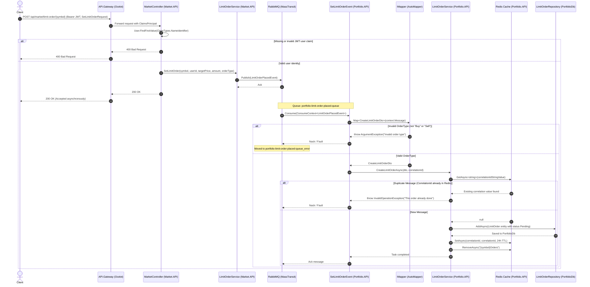

# Create Limit Order Flow

> Asynchronous event-driven flow for placing a limit order from Market.API to Portfolio.API with JWT authentication, validation, duplicate detection, and database persistence.

---

## Sequence Diagram

---

## Process Description

1. The client submits a limit order request by issuing an authenticated `POST /api/market/limit-order/{symbol}` request carrying a bearer JWT and JSON payload containing `TargetPrice`, `Amount`, and `OrderType`.
2. The Ocelot API Gateway forwards the request to `Market.API`, where `MarketController.SetLimitOrder` inspects `User.FindFirstValue(ClaimTypes.NameIdentifier)` to resolve the caller's `Guid` user identity.
3. Upon validating the token claim, `MarketController` delegates to `Market.API.Application.Services.LimitOrderService.SetLimitOrder`, which publishes a `LimitOrderPlacedEvent` to RabbitMQ via MassTransit `IPublishEndpoint`.
4. `MarketController` immediately returns `200 OK` to the client, confirming that the limit order has been accepted for asynchronous processing.
5. RabbitMQ routes `LimitOrderPlacedEvent` through exchange `Shared.Messages:LimitOrderPlacedEvent` into queue `portfolio-limit-order-placed-queue`.
6. In `Portfolio.API`, the `SetLimitOrderEvent` consumer receives the message and invokes `IMapper.Map<CreateLimitOrderDto>(context.Message)`. The mapper runs `ParseOrderType`, validating that the string matches enum `LimitOrderType.Buy` or `LimitOrderType.Sell`.
7. The consumer calls `Portfolio.API.Application.Services.LimitOrderService.CreateLimitOrderAsync`, passing the mapped DTO and the event's `CorrelationId`.
8. The service checks Redis for an existing entry matching the `CorrelationId`. If found, it rejects the message to ensure strict idempotency.
9. If no duplicate exists, a new `LimitOrder` entity with status `LimitOrderStatus.Pending` is created and persisted to PostgreSQL `PortfolioDb` via `LimitOrderRepository.AddAsync`.
10. Finally, the service stores the `CorrelationId` in Redis with a 24-hour expiration window and invalidates cached symbol orders (`{symbol}Orders`) to force subsequent price matching queries to read fresh state.

---

## Failure Paths

- **Missing or Invalid Authentication Claim:** If the incoming request lacks a valid JWT or the `ClaimTypes.NameIdentifier` claim is null, `MarketController` returns `400 Bad Request` without publishing any event.
- **Invalid Order Type:** If `OrderType` is not parsable to `LimitOrderType.Buy` or `LimitOrderType.Sell`, `LimitOrderMapping.ParseOrderType` throws an `ArgumentException`. MassTransit captures the unhandled exception and transfers the poison message to the dead-letter queue `portfolio-limit-order-placed-queue_error`.
- **Duplicate Message Delivery:** If network retries deliver the same `CorrelationId` more than once, `LimitOrderService.CreateLimitOrderAsync` detects the key in Redis and throws `InvalidOperationException("This order already done")`, preventing duplicate database records.
- **Message Broker Outage:** If RabbitMQ is unavailable when `MarketController` calls `publishEndpoint.Publish`, the call throws an exception caught in `LimitOrderService`, logging the error and preventing a false success acknowledgement.

---

## Sources

- [MarketController.cs](file:///c:/CryptoMarketProject/backend/Market.API/Controllers/MarketController.cs#L39-L51) — Controller endpoint extracting JWT claims and invoking limit order placement.
- [LimitOrderService.cs (Market.API)](file:///c:/CryptoMarketProject/backend/Market.API/Application/Services/LimitOrderService.cs#L7-L28) — Market service publishing `LimitOrderPlacedEvent`.
- [LimitOrderPlacedEvent.cs](file:///c:/CryptoMarketProject/backend/Shared.Messages/LimitOrderPlacedEvent.cs#L5-L16) — Message contract carrying order parameters and CorrelationId.
- [SetLimitOrderEvent.cs](file:///c:/CryptoMarketProject/backend/Portfolio.API/Consumers/SetLimitOrderEvent.cs#L10-L17) — MassTransit consumer in Portfolio.API handling incoming limit order events.
- [LimitOrderMapping.cs](file:///c:/CryptoMarketProject/backend/Portfolio.API/Application/Mappings/LimitOrderMapping.cs#L22-L32) — AutoMapper profile validating `OrderType` enum parsing.
- [LimitOrderService.cs (Portfolio.API)](file:///c:/CryptoMarketProject/backend/Portfolio.API/Application/Services/LimitOrderService.cs#L69-L98) — Portfolio service enforcing Redis idempotency and persisting the order.
- [LimitOrderRepository.cs](file:///c:/CryptoMarketProject/backend/Portfolio.API/Infrastructure/Repositories/LimitOrderRepository.cs#L12-L20) — Entity Framework Core repository persisting the `LimitOrder` entity.
