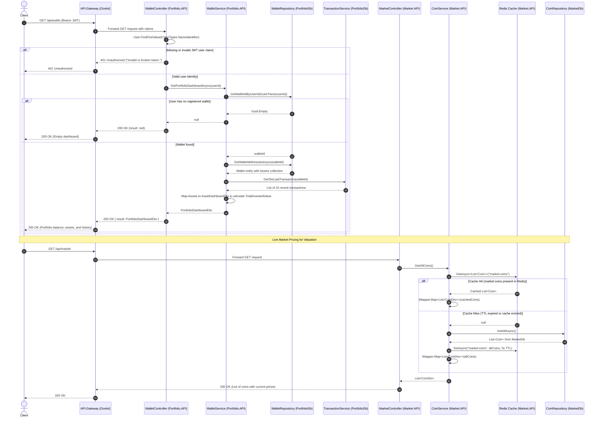

# Dashboard Read Flow

> Read-heavy flow retrieving user portfolio holdings, recent transactions, and live coin market valuations, highlighting Redis cache hits and misses.

---

## Sequence Diagram

---

## Process Description

1. To render the user dashboard, the frontend client makes an authenticated `GET /api/wallet` request to the API Gateway using a Bearer JWT.
2. `WalletController.GetDashboard` validates the token claim `ClaimTypes.NameIdentifier`. If missing, the request terminates with `401 Unauthorized ("Invalid or broken token.")`.
3. `WalletService.GetPortfolioDashboardAsync` resolves the user's `walletId` from PostgreSQL `PortfolioDb` via `WalletRepository.GetWalletIdByUserId`.
4. If a wallet exists, `WalletRepository.GetWalletWithAssetsAsync` retrieves the wallet record along with its associated crypto asset collection.
5. `TransactionService.GetTenLastTransaction(walletId)` queries the 10 most recent transactions for audit display.
6. The service aggregates asset purchase costs to determine `TotalInvestedValue` and returns a comprehensive `PortfolioDashboardDto` containing fiat balance, crypto holdings, wallet address, and history.
7. In parallel or immediately following, the client issues `GET /api/market` to fetch real-time market valuations.
8. `MarketController.GetAllCoins` calls `CoinService.GetAllCoins()`, which queries Redis for cache key `market:coins`.
9. If found in Redis (cache hit), the cached coin list is immediately mapped to `CoinDto` without database interaction.
10. If the cache is cold or expired (cache miss), `CoinService` queries PostgreSQL `MarketDb` via `CoinRepository.GetAllAsync`, caches the result in Redis with a 5-second TTL, and returns the response.

---

## Failure Paths

- **Expired or Malformed JWT:** Requests lacking a valid token fail authentication or claim inspection in `WalletController`, returning `401 Unauthorized`.
- **Unregistered User Wallet:** If a valid JWT belongs to a user who has not completed wallet initialization, `GetWalletIdByUserId` returns `Guid.Empty`, returning an empty dashboard response rather than crashing.
- **Redis Cache Unavailable:** If Redis encounters downtime or connection timeouts during `GET /api/market`, `CoinService` falls back gracefully to querying `CoinRepository.GetAllAsync` directly from PostgreSQL `MarketDb`.
- **Database Connectivity Fault:** If PostgreSQL is down when resolving the wallet or transactions, Entity Framework Core throws a database exception handled by ASP.NET Core exception middleware returning a 500 error.

---

## Sources

- [WalletController.cs](file:///c:/CryptoMarketProject/backend/Portfolio.API/Controllers/WalletController.cs#L15-L27) — Dashboard read controller endpoint.
- [WalletService.cs (GetPortfolioDashboardAsync)](file:///c:/CryptoMarketProject/backend/Portfolio.API/Application/Services/WalletService.cs#L430-L458) — Aggregates wallet holdings, balances, and recent transaction records.
- [TransactionService.cs](file:///c:/CryptoMarketProject/backend/Portfolio.API/Application/Services/TransactionService.cs#L43-L49) — Fetches the ten most recent transactions from `PortfolioDb`.
- [MarketController.cs](file:///c:/CryptoMarketProject/backend/Market.API/Controllers/MarketController.cs#L53-L58) — Controller returning current coin listings and prices.
- [CoinService.cs](file:///c:/CryptoMarketProject/backend/Market.API/Application/Services/CoinService.cs#L35-L51) — Implements Redis cache check and PostgreSQL fallback for `market:coins`.
