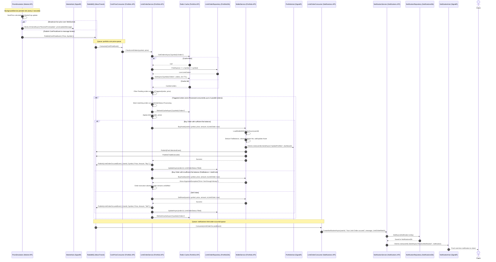

# Limit Order Triggered Flow

> Cross-service flow initiated by simulated price ticks, triggering pending limit orders in Portfolio.API, executing trades, and dispatching real-time notifications via Notifications.API and SignalR.

---

## Sequence Diagram

---

## Process Description

1. The `PriceSimulation` background service in `Market.API` executes on a continuous loop (tick interval: 2 seconds), generating updated coin prices and market capitalization values based on trending models.
2. For each coin, `PriceSimulation` concurrently broadcasts a live price tick over WebSocket via `MarketHub.Clients.All.SendAsync("ReceivePriceUpdate", ...)` and publishes a `CoinPriceEvent` to RabbitMQ via MassTransit.
3. RabbitMQ delivers the message to the queue `portfolio-coin-price-queue`, where `CoinPriceConsumer` in `Portfolio.API` intercepts it and delegates to `LimitOrderService.CheckLimitOrders(symbol, price)`.
4. `LimitOrderService` checks Redis for cached active orders (`{symbol}:Orders`). On a cache miss, it retrieves orders from PostgreSQL `PortfolioDb` via `LimitOrderRepository.FindAsync` and writes the results to Redis with a 2-minute TTL.
5. The service inspects all pending orders matching the symbol, checking if current price crosses target limits (`Buy: currentPrice <= TargetPrice`, `Sell: currentPrice >= TargetPrice`).
6. If matching orders exist, their status is temporarily transitioned to `Processing` in cache to guard against duplicate pickup.
7. Orders are processed concurrently using `Parallel.ForEachAsync` with `MaxDegreeOfParallelism = 4`. For each order, `ApplyLimitOrder` is invoked.
8. For a Buy order, `WalletService.BuyAsset` verifies that `wallet.FiatBalance >= totalCost`. It applies maker fee calculations (`FeeSettings.MakerFeeRate`), debits fiat balance, credits asset quantity, logs a transaction record, dispatches a real-time portfolio update via `PortfolioHub`, and publishes `FeeCollectionEvent` and `TradeExecuted`.
9. Upon successful trade completion, `LimitOrderService` publishes `LimitOrderOccuredEvent` to RabbitMQ and marks the order as `Filled` in PostgreSQL `PortfolioDb`.
10. `Notifications.API` consumes `LimitOrderOccuredEvent` through `LimitOrderConsumer`. It records a notification in PostgreSQL `NotificationsDb` and immediately pushes the alert to the affected user via SignalR `NotificationHub`.

---

## Failure Paths

- **Insufficient Fiat Balance on Trigger:** If a user placed a Buy limit order but subsequently spent or withdrew their fiat balance before the order triggered, `WalletService.BuyAsset` throws `ArgumentException("Error: Not Enough Money!")`. The execution fails, and the order is not marked as `Filled`.
- **Insufficient Asset Balance for Sell Orders:** If a user placed a Sell limit order but transferred out the underlying crypto asset, `WalletService.SellAsset` throws `ArgumentException("Error: Not enough asset to sell or asset not found!")`.
- **Database or Redis Connectivity Fault:** If Redis is down during price checks, `GetOrdersAsync` falls back to querying `LimitOrderRepository` directly. If PostgreSQL is also unavailable, the consumer faults and MassTransit moves the event to `portfolio-coin-price-queue_error`.
- **SignalR Client Disconnection:** If the targeted user is disconnected or offline when notifications are generated, SignalR drops the transient push gracefully, but the notification remains safely stored in PostgreSQL `NotificationsDb` for retrieval upon next login via `GET /api/notifications`.

---

## Sources

- [PriceSimulation.cs](file:///c:/CryptoMarketProject/backend/Market.API/Infrastructure/BackgroundServices/PriceSimulation.cs#L22-L70) — Background service generating price updates and publishing `CoinPriceEvent`.
- [CoinPriceConsumer.cs (Portfolio.API)](file:///c:/CryptoMarketProject/backend/Portfolio.API/Consumers/CoinPriceConsumer.cs#L7-L14) — Consumer initiating limit order evaluation on price events.
- [LimitOrderService.cs (Portfolio.API)](file:///c:/CryptoMarketProject/backend/Portfolio.API/Application/Services/LimitOrderService.cs#L19-L67) — Order matching logic and parallel trade execution.
- [WalletService.cs (Portfolio.API)](file:///c:/CryptoMarketProject/backend/Portfolio.API/Application/Services/WalletService.cs#L109-L191) — Wallet balance verification, balance debit/credit, and trade publishing.
- [LimitOrderConsumer.cs (Notifications.API)](file:///c:/CryptoMarketProject/backend/Notifications.API/Consumers/LimitOrderConsumer.cs#L7-L19) — Consumer handling `LimitOrderOccuredEvent`.
- [NotificationService.cs (Notifications.API)](file:///c:/CryptoMarketProject/backend/Notifications.API/Application/Services/NotificationService.cs#L18-L27) — Notification persistence and SignalR delivery.
